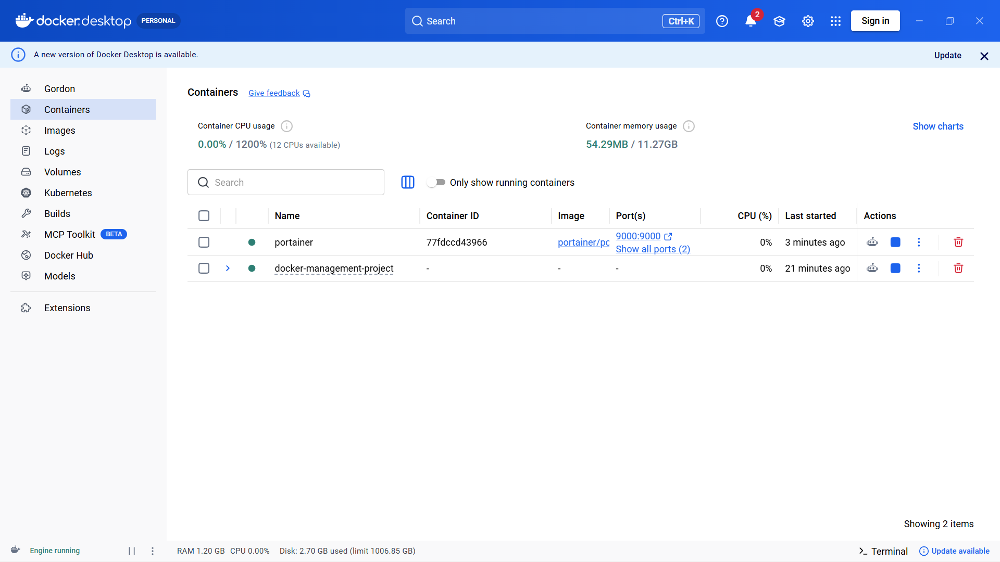
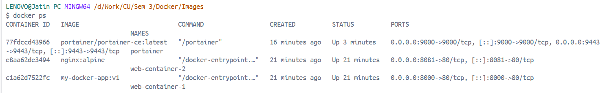
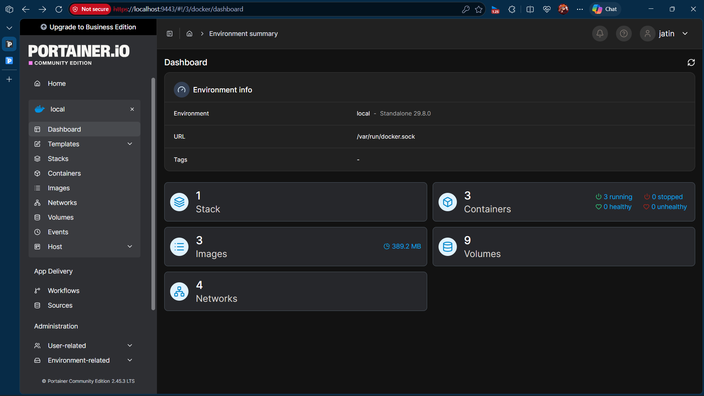
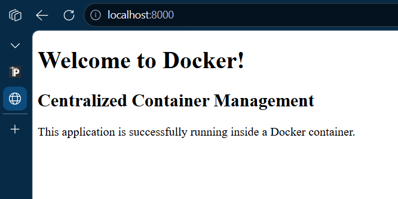

# Centralized Docker Deployment and Container Management


## Project Overview

This project demonstrates centralized application deployment
and container management using Docker, Docker Compose and
Portainer.

It is inspired by Docker's real-world case study about
deploying and managing Docker Desktop across an organization.

The project implements a simplified environment where
multiple applications are deployed, monitored, updated
and managed through containers.

## Objectives

- Understand Docker containerization.
- Create custom Docker images.
- Deploy multiple containers.
- Automate deployment using Docker Compose.
- Manage containers through Portainer.
- Monitor container logs and resource usage.
- Perform container cleanup and maintenance.
- Update and redeploy applications.

## Technologies Used

| Technology | Purpose |
|---|---|
| Docker | Containerization |
| Docker Compose | Multi-container deployment |
| Nginx | Web server |
| Portainer | Container management dashboard |
| HTML | Sample web application |
| Git | Version control |
| GitHub | Source code hosting |

## Project Architecture

The project uses Docker Compose to deploy
multiple containers on a Docker host.

Portainer provides a graphical dashboard
for managing and monitoring containers.


## Repository Structure

```text
docker-management-project/
├── app/
│   └── index.html
├── screenshots/
├── docs/
│   ├── architecture.md
│   └── commands.md
├── Dockerfile
├── docker-compose.yaml
├── .dockerignore
├── .gitignore
├── README.md
└── LICENSE
```

## Installation and Setup

### 1. Clone the repository

```bash
git clone https://github.com/Jatin-Tasoria/docker-management-project.git

cd docker-management-project
```

### 2. Build and deploy containers

```bash
docker compose up -d --build
```

### 3. Verify running containers

```bash
docker ps
```

### 4. Access applications

| Application | URL |
|---|---|
| Custom Web Application | http://localhost:8000 |
| Nginx Application | http://localhost:8081 |
| Portainer Dashboard | https://localhost:9443 |

### 5. Manage containers

```bash
docker stop web-container-1

docker start web-container-1

docker restart web-container-1

docker logs web-container-1
```

## Container Maintenance

Check Docker disk usage:

```bash
docker system df
```

Remove unused images:

```bash
docker image prune
```

Remove stopped containers:

```bash
docker container prune
```

## Screenshots

### Docker Desktop



### Running Containers



### Portainer Dashboard



### Application Output



---

## Learning Outcomes

- Understanding Docker architecture.
- Building and managing Docker images.
- Deploying multiple containers.
- Using Docker Compose for automation.
- Monitoring containers using Portainer.
- Performing Docker resource cleanup.
- Understanding container lifecycle management.

## Conclusion

This project demonstrates how Docker simplifies
application deployment, management and maintenance.

By combining Docker Compose and Portainer,
container operations become easier to automate
and monitor through command-line and graphical tools.

## Reference

Docker Case Study:

https://www.docker.com/customer-stories/docker/

## Author

**Jatin Tasoria**

GitHub: https://github.com/Jatin-Tasoria
